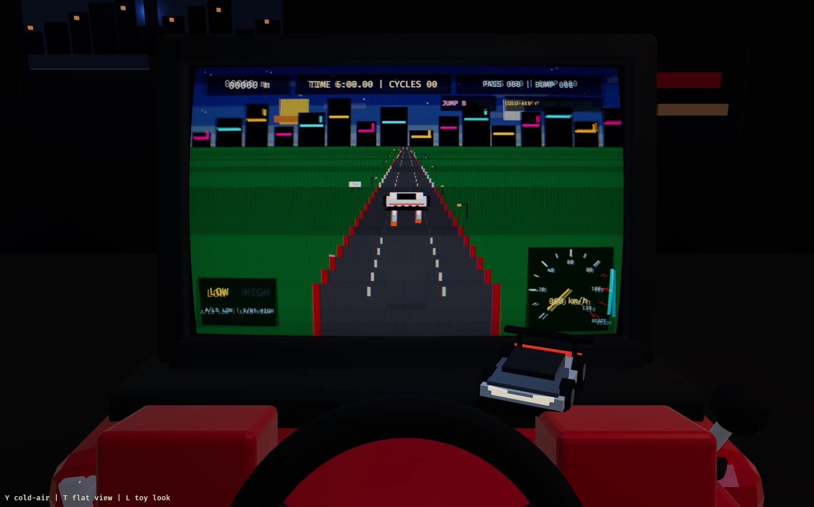
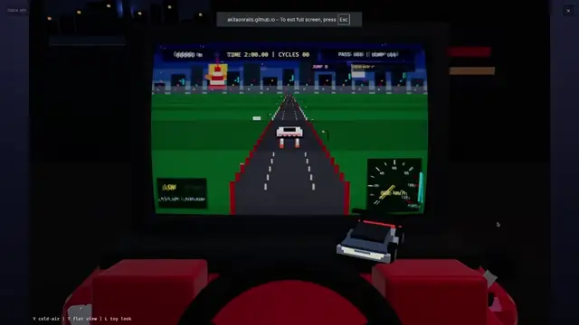

# Fun to Drive — web

[](https://github.com/akitaonrails/playmate-fun-to-drive/actions/workflows/ci.yml)

<p align="center">
  <a href="https://akitaonrails.github.io/playmate-fun-to-drive/">
    
  </a>
</p>

<p align="center">
  <a href="https://akitaonrails.github.io/playmate-fun-to-drive/">
    
  </a><br>
  The game includes a fullscreen button in its upper-right corner.
</p>

## Gameplay

<p align="center">
  <a href="docs/media/playthrough.mp4">
    
  </a>
</p>

<p align="center">
  <strong><a href="docs/media/playthrough.mp4">▶ Watch the full 2:18 playthrough with sound</a></strong>
</p>

A web/WASM recreation of the 80s/90s electromechanical dashboard driving
toys (Tomy Turnin' Turbo Dashboard 1983, **Playmates Fun-to-Drive Corvette
Dashboard 1985**, Tectoy Turbo Video Driver 1991): the 2D drum game plays
*on the screen of a 3D toy* sitting on a desk, and the toy physically
reacts — steering wheel, gear lever, ignition key, G-force body lean, and a
full-body jolt (with gamepad rumble) when you crash.

Choose a two-, six-, or ten-minute run. Drive cleanly and quickly to complete as many
day/night cycles as possible, pass traffic, collect cold-air charges and rare Jump Kicks, and
avoid bumps.
Easy runs at 80% of Hard's road speed, Medium at 90%, and Hard at full speed;
gear thresholds scale with the selected difficulty.
Six original 100-second PSG tracks rotate with the day/night cycle, spanning
upbeat pop-rock, tropical fusion, city-pop, dramatic racing rock, hard rock,
and tense industrial styles.
At time-up, enter three initials for the local top-10 leaderboard for that
difficulty (top five shown on the toy screen). Easy, Medium, and Hard keep
separate local top-10 boards.

## Controls

| Input | Action |
|---|---|
| Arrow Left/Right | Steer (tap = light nudge, hold = full lock ramp) |
| Q / E | Select LOW / HIGH gear (HIGH unlocks at 10 m/s / 36 km/h) |
| Y | Fire the cold-air thruster after collecting all three charges |
| B / Space | Use a collected Jump Kick: leap, spin, and clear traffic—unless you land on it |
| A-Z / Backspace / Enter | Enter and submit three initials after time-up |
| Left/Right + Enter | Select and start Easy / Medium / Hard |
| R | Restart while driving; return to difficulty selection from the leaderboard |
| T | Toggle toy view (game view ⇄ toy-on-desk view) |
| L | Cycle the rolling-tube look dial (0 / 0.5 / 1) |
| M | Mute / unmute audio |
| [ / ] | Music volume down / up |
| - / = | Sound-effects volume down / up |
| C or gamepad X (run menu) | Toggle the CRT display shader |
| Gamepad | Left stick steers, LT brakes, A/LB select LOW, X/RB select HIGH, A confirms menus, Y fires cold-air, B uses Jump Kick, rumble on bumps |
| Touch | Enable with the upper-left button; left thumb steers, right thumb swipes LOW/HIGH and holds brake, with COLD-AIR/JUMP KICK buttons above the shift area; tap the game screen to pause |

## Run it

```sh
make serve        # dev server with auto-reload (trunk), opens the browser
```

## Develop

```sh
make check        # fmt + clippy (-D warnings) + unit tests + native build
make test         # unit tests only (game-core: deterministic sim logic)
make shots        # Playwright screenshot/state harness (needs make serve)
make package      # release wasm bundle -> release/fun-to-drive-web.zip
make build-wasm-webgpu  # WebGPU-capable build (falls back to WebGL2)
```

`make ci` runs the same native, production-WASM, packaging, and audible browser
transition checks as GitHub Actions.
Pushes to `main` publish the validated web bundle through GitHub Pages. After
creating the repository, select **GitHub Actions** once under
**Settings → Pages → Build and deployment → Source**.

- Game logic: `crates/game-core` (pure, seeded, deterministic unit tests).
- Presentation: `crates/game-app` (Bevy 0.20, wasm32 via trunk).
- Docs: `docs/REQUEST.md` (charter), `docs/PLAN.md` (milestones + deferred
  tuning), `docs/DECISIONS.md`, `research/` (the real toys).
- 3D pipeline: `tools/astra/generate-model.sh` (astra writes a parametric
  Blender script; headless Blender exports `assets/models/toy.glb`).
- Visual QA: `tools/astra/eyes.sh` (astra reads screenshots against written
  expectations — the dev agent's eyes).

For deterministic browser QA, append `?qa_session_secs=2` (accepted range:
1–600 seconds). This replaces only the active QA run duration and does not
change the competitive Easy/Medium/Hard durations; first-load selection defaults
to Medium (six minutes). QA mode uses an empty ephemeral leaderboard and never
reads or writes production leaderboard storage. Normal leaderboard data is
local to the browser under the versioned `fun-to-drive.leaderboard.v2` key;
valid v1 rows migrate to the Hard board;
stored totals above conservative 600-second plausibility ceilings (100 cycles
or 100,000 passed/bumped cars) invalidate the stored board.

Transition tests may additionally use `qa_start_environment_time=99` while QA
mode is active. The value is constrained to the first 100-second cycle and is
ignored during normal leaderboard runs.

For weaker GPUs, append `?quality=low`. This reduces the offscreen game view
from 960×600 to 720×450 and disables bloom without changing simulation logic.
